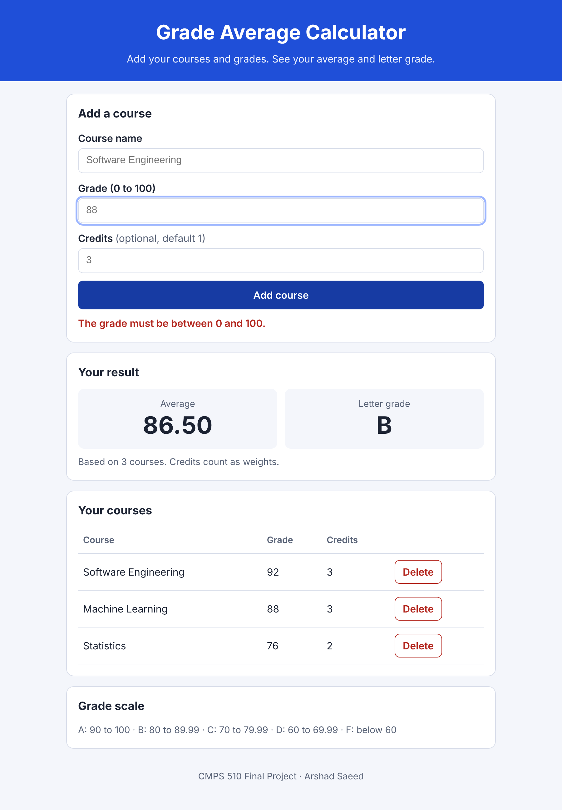

# Grade Average Calculator

CMPS 510 Principles and Concepts of Software Engineering — Final Project (Project #8)

Student: Arshad Saeed · Instructor: Dr. Tsige Tessema · Bay Atlantic University

  **Live app:** https://arshengr.github.io/grade-average-calculator/
  
**GitHub repo:** https://github.com/arshengr/grade-average-calculator



## What it does

A student adds courses with a grade (0 to 100) and optional credits. The app shows:

- the average (weighted by credits),
- the letter grade,
- a list of all courses, with a Delete button for each.

The list is saved in the browser, so it is still there after a refresh. There is no server, no database, and no sign-in.

## Grade scale

| Average | Letter |
|---|---|
| 90 to 100 | A |
| 80 to 89.99 | B |
| 70 to 79.99 | C |
| 60 to 69.99 | D |
| below 60 | F |

The average is rounded to 2 decimals first. The letter comes from that rounded number, so what you see always matches.

## How to run

Open `index.html` in any browser. Nothing to install.

## How to test

You need Node.js 18 or newer.

```
npm test
```

This runs 11 unit tests in `tests/grades.test.js`. They check the letter boundaries, the average (simple and weighted), and the input checks.

## How the code works

- `index.html` is the page structure.
- `style.css` is the look. It works on phones and desktops.
- `app.js` has two parts:
  1. **Logic** — `letterGrade`, `calculateAverage`, `validateCourse`. These do not touch the page, so they are easy to test.
  2. **Page code** — reads the form, saves to `localStorage`, and draws the table. It uses `textContent` (not `innerHTML`), so typed text can never run as code.

Weighted average = sum of (grade × credits) ÷ sum of credits. If every course has 1 credit, it is the normal average.

## Publish on GitHub Pages

1. Create a new public repo on GitHub and upload all files in this folder.
2. Go to Settings → Pages.
3. Under "Build and deployment", choose "Deploy from a branch", branch `main`, folder `/ (root)`. Save.
4. After about a minute, your link is `https://YOUR-USERNAME.github.io/REPO-NAME/`.
5. Paste that link at the top of this README.

## Tools and AI used

- HTML, CSS, JavaScript (no frameworks)
- Node.js built-in test runner (`node:test`)
- Playwright, for the browser check and screenshot
- **AI disclosure:** I built this project with help from Claude (an AI assistant by Anthropic). Claude helped write the code, tests, and report. I reviewed the code, ran the tests, and can explain how it works.
